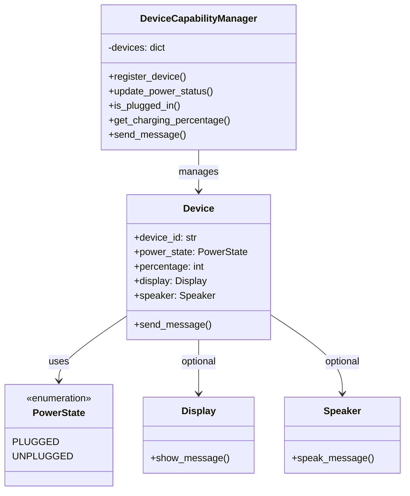

# Device Capability Manager

## 1. Problem Statement

Design a system to manage multiple devices with common power information and optional messaging capabilities.

Every device has:

- A unique device ID
- A power connection state (plugged in or unplugged)
- A charging percentage between 0 and 100
- Optional display and speaker capabilities

A device may support a display, a speaker, both, or neither.

When a message is sent, the system must generate an output record for every supported capability. Display output must always appear before speaker output, regardless of registration order.

Power state and charging percentage do not affect message delivery.

## 2. Functional Requirements

| Operation | Description |
|---|---|
| `register_device()` | Register a device with its power state and capabilities |
| `update_power_status()` | Update a device's power state and charging percentage |
| `is_plugged_in()` | Check whether a device is connected to power |
| `get_charging_percentage()` | Retrieve the device's current charging percentage |
| `send_message()` | Generate message records for all supported capabilities |

**Message output rules:**

- Display output: `DISPLAY,message`
- Speaker output: `SPEAKER,message`
- Display output must precede speaker output.
- Unsupported capabilities must not produce records.
- Devices without messaging capabilities return an empty list.
- Message content must remain unchanged.

## 3. Class Design

The implementation consists of five classes.

### PowerState

An enumeration representing the power connection state:

- `PLUGGED`
- `UNPLUGGED`

### Display

Handles formatting messages for display output.

`show_message(message)` returns `DISPLAY,message`.

### Speaker

Handles formatting messages for speaker output.

`speak_message(message)` returns `SPEAKER,message`.

### Device

Represents an individual device.

**Attributes:**

- `device_id`: Unique device identifier
- `power_state`: Current power connection state
- `percentage`: Current charging percentage
- `display`: Optional Display object
- `speaker`: Optional Speaker object

**Method:** `send_message(message)`

Delegates message formatting to the supported capabilities and returns their output records in the required order.

### DeviceCapabilityManager

Manages registered devices through a dictionary keyed by device ID.

```python
self.devices = {}
```

Each key maps to its corresponding `Device` object, enabling efficient device lookup and updates.

The manager provides registration, power updates, status queries, and message sending.

## 4. UML Class Diagram



## 5. Design Approach

### Device Registration

When `register_device()` is called:

1. Convert the `plugged_in` boolean to a `PowerState` enum.
2. Create a `Display` object if the device supports `"DISPLAY"`.
3. Create a `Speaker` object if the device supports `"SPEAKER"`.
4. Construct a `Device` object with its power information and capabilities.
5. Store the device in the manager's dictionary using its unique ID.

### Power Status Updates

`update_power_status()` retrieves the existing device from the dictionary and updates only its power state and charging percentage.

Its display and speaker capabilities remain unchanged.

### Message Processing

When `send_message()` is called:

1. The manager retrieves the device by its ID.
2. The manager delegates the request to `Device.send_message()`.
3. The device checks whether it has a display and appends the display output if supported.
4. The device checks whether it has a speaker and appends the speaker output if supported.
5. The collected output records are returned.

Because the display is checked first, output ordering is deterministic.

## 6. Object-Oriented Design Principles

### Encapsulation

The `Device` class groups device information and messaging behavior.

The manager exposes operations for managing devices without requiring callers to access the underlying dictionary.

### Composition (HAS-A Relationship)

A device contains optional `Display` and `Speaker` objects.

This supports different capability combinations without requiring a separate device subclass for each combination.

**Why composition instead of inheritance?**

Display and speaker are independent capabilities rather than specialized types of devices.

Using inheritance could lead to unnecessary subclasses such as:

- `DisplayDevice`
- `SpeakerDevice`
- `DisplaySpeakerDevice`

Composition allows capabilities to be combined while keeping the design simple and flexible.

### Single Responsibility Principle (SRP)

Each class has a focused responsibility:

- `Display`: Formats display output.
- `Speaker`: Formats speaker output.
- `Device`: Maintains device information and coordinates supported capabilities.
- `DeviceCapabilityManager`: Registers, locates, and manages devices.

### Delegation

The manager delegates messaging to the device, which delegates output formatting to its supported capabilities.

This separates device management from capability-specific behavior.

## 7. Example Usage

### Device With Both Capabilities

```python
manager = DeviceCapabilityManager()

manager.register_device(
    "travel-tablet",
    False,
    58,
    ["SPEAKER", "DISPLAY"]
)

print(manager.is_plugged_in("travel-tablet"))
# False

print(manager.get_charging_percentage("travel-tablet"))
# 58

print(manager.send_message("travel-tablet", "Navigation ready"))
# ['DISPLAY,Navigation ready', 'SPEAKER,Navigation ready']
```

### Updating Power Status

```python
manager.update_power_status("travel-tablet", True, 75)

print(manager.is_plugged_in("travel-tablet"))
# True

print(manager.get_charging_percentage("travel-tablet"))
# 75
```

### Device With Display Only

```python
manager.register_device("kitchen-panel", True, 91, ["DISPLAY"])

print(manager.send_message("kitchen-panel", "Timer finished"))
# ['DISPLAY,Timer finished']
```

### Device With Speaker Only

```python
manager.register_device("audio-pod", True, 73, ["SPEAKER"])

print(manager.send_message("audio-pod", "Connection complete"))
# ['SPEAKER,Connection complete']
```

### Device Without Message Capabilities

```python
manager.register_device("sensor-node", False, 27, [])

print(manager.send_message("sensor-node", "Reading recorded"))
# []
```

## 8. Complexity Analysis

Let N represent the number of registered devices and M the message length.

| Operation | Time Complexity |
|---|---|
| `register_device()` | O(1) average |
| `update_power_status()` | O(1) average |
| `is_plugged_in()` | O(1) average |
| `get_charging_percentage()` | O(1) average |
| `send_message()` | O(M), including output string construction |

**Space Complexity:**

- Device storage: O(N)
- Message output: O(M)
- Device lookup: O(1) average using a dictionary

Each device supports at most two capabilities, so message dispatch performs a constant number of capability checks.

## 9. Edge Cases

| Scenario | Expected Behavior |
|---|---|
| Display only | Return one display record |
| Speaker only | Return one speaker record |
| Both capabilities | Return display first, then speaker |
| Neither capability | Return an empty list |
| Unplugged device | Message delivery remains available |
| 0% charging percentage | Message delivery remains available |
| Updated power information | Existing capabilities remain unchanged |
| Speaker registered before display | Display output still comes first |

The implementation assumes valid inputs according to the problem constraints, including unique device IDs and valid charging percentages.

## 10. How to Run

**Requirements:** Python 3

Clone the repository:

```bash
git clone https://github.com/saiteja0367/low-level-design-python.git
```

Navigate to the project directory:

```bash
cd low-level-design-python/02-device-capability-manager
```

Run:

```bash
python main.py
```

The program executes the sample scenarios and prints their results.

## 11. Key Learnings

- Designing modular systems with object-oriented programming.
- Using composition to represent optional capabilities.
- Managing multiple objects efficiently with Python dictionaries.
- Separating power information from message-processing behavior.
- Applying SRP and delegation to keep responsibilities clear.
- Preserving deterministic output ordering.
- Avoiding unnecessary inheritance and overengineering.

---

**Source Code:** [main.py](main.py)

**Language:** Python 3  
**Focus:** Object-Oriented Design, Composition, and Maintainable Low-Level Design
